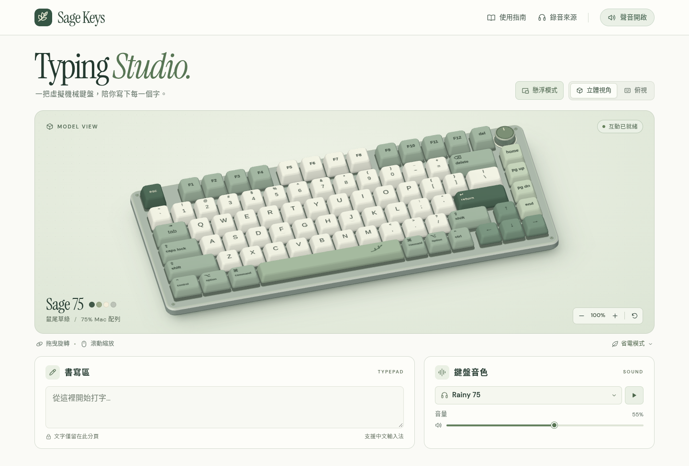
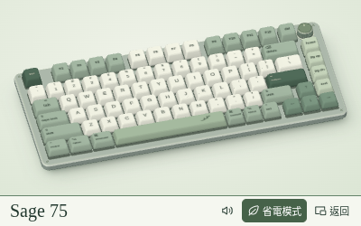

# Sage Keys

Sage Keys 是免費的 3D 機械鍵盤打字工作室。瀏覽器會即時建立一把 82 鍵的 Sage 75，並以錄製的機械鍵盤聲回應敲擊。桌面版 Chrome 可把同一把鍵盤移到置頂小窗。打開網站即可使用。

**[開啟 Sage Keys](https://annecat-bit.github.io/sage-keys/)** · [測試及效能報告](docs/TESTING.md) · [完整錄音紀錄](docs/AUDIO.md)

## 使用

1. 點選「書寫區」，使用英文或自己慣用的輸入法打字。按鍵依實體位置下沉。在俯視視角，按住的鍵帽會略為變深，放手時跟隨鍵程恢復原色。中文字交由原生輸入法組字及選字。
2. 在鍵盤模型上拖曳旋轉，滾動或雙指捏合縮放。可切換立體與俯視、用加減按鈕微調，或按圓箭頭重設視角。
3. 選取 Rainy 75、HHKB Topre 或 Cherry MX Brown。播放鍵可試聽，音量滑桿和右上角喇叭可調整或靜音。瀏覽器需要一次使用者互動才能啟動聲音。
4. 畫質預設為省電，動畫上限為 30 fps，裝置像素比例上限為 1.25。標準模式的上限分別為 60 fps 與 1.75。畫面靜止後停止繪製，音訊閒置約 1.2 秒後暫停。

## 桌寵懸浮小窗

在支援 Document Picture-in-Picture 的桌面版 Chrome 點選「懸浮模式」。預設請求的**內容區**是 400 × 250 CSS 像素，已在 300 × 190 測試。拖曳系統標題列移動，拉動視窗邊緣調整大小。實際最小尺寸和跨全螢幕、Spaces 的置頂行為由瀏覽器與作業系統決定。

小窗只有鍵盤、喇叭、省電和返回按鈕。畫質按鈕顯示目前的「省電模式」或「標準模式」，兩邊可以互相切換。用滑鼠切換靜音或畫質後，可直接繼續在小窗試打。按 Tab 亦可逐一操作控制項。鍵盤可以留在 Word、ChatGPT 或其他網站上方。只有主工作室或小窗收到的按鍵才觸發回饋。主頁的書寫區在移動鍵盤後仍可使用。點「返回」、主頁的「收回鍵盤」，或關掉小窗，都會把原有鍵盤放回。主分頁要保持開啟，重新整理或關閉會結束小窗。[Chrome 官方 API 說明](https://developer.chrome.com/docs/web-platform/document-picture-in-picture)

## 實作與隱私

- 原生 HTML、CSS 與 JavaScript，Three.js r160（npm 0.160.1）隨專案提供。鍵帽、軸座、外殼、旋鈕及字面全由程式生成。陰影使用一次生成的紋理。
- 24,530 個三角形分成 5 次繪製。相機固定時，只重畫變動鍵帽投影涵蓋的區域。主頁與小窗移動同一個 DOM 畫布及 WebGL context，視窗交接時更換排程與尺寸觀察器。
- 使用鍵盤事件的 `code` 控制形狀，原生 `textarea` 負責文字、選取及 IME。鍵盤事件處理器保留系統與瀏覽器捷徑的預設行為。
- 只在瀏覽器本地儲存音色、音量、靜音及畫質。重新整理或離開主頁會清除書寫內容。沒有後端、帳戶、分析、第三方埋點或系統鍵盤監察。站內文字、模型、字型及錄音皆由本站提供。
- 每種音色有四個輪換的一般取樣，另有 Space、Enter、Backspace 各一段。最多同時播放五段。取樣用於特定鍵位的分配詳見[錄音紀錄](docs/AUDIO.md)。

## 已知問題與驗證範圍

- Chrome、瀏覽器設定或內嵌環境不支援 Document PiP 時，「懸浮模式」會顯示提示。桌面瀏覽器原生控制列的外觀隨平台不同。
- WebGL 無法建立或 context 遺失時，工作室會改用可回應按鍵的二維鍵盤，保留書寫、音效和縮放。二維模式固定俯視。
- 軟體繪圖可造成明顯 CPU 負載。雲端 SwiftShader 實測、記憶體口徑及平台限制均列於[效能報告](docs/TESTING.md)。沒有 MacBook 耗電、風扇或溫度的實機測量。
- 雲端已測 Chromium 的繁中組字、提交與取消。macOS 的倉頡、速成、拼音候選視窗以及 Safari 原生輸入體驗仍需在實機逐項驗證。系統保留鍵、部分 Fn/媒體鍵和虛擬鍵盤可能不提供實體鍵碼。
- 錄音作者未逐鍵標註 Space、Enter、Backspace。第一版未收錄環境雨聲。

## 專案導覽

| 檔案 | 用途 |
| --- | --- |
| `index.html`、`style.css` | 工作室、操作說明、錄音資訊及小窗控制 |
| `src/layout.js`、`src/model.js` | Mac 配列、低多邊形模型、紋理與鍵程 |
| `src/view.js` | 相機、視窗生命週期、按需繪製及 WebGL 降級 |
| `src/sound.js`、`assets/audio/` | 錄音取樣與低延遲播放 |
| `src/app.js`、`src/floating.js` | 本地偏好、輸入事件與 Document Picture-in-Picture |
| `tests/`、`docs/` | 雲端回歸測試、效能量測、截圖與研究報告 |

GitHub Pages 從 `main` 的 `/(root)` 發布，沒有建置步驟。網站使用相對路徑，在專案子路徑和重新整理後皆可載入。Three.js 的 MIT 授權位於 [assets/THREE-LICENSE.txt](assets/THREE-LICENSE.txt)，字型授權隨 [assets/fonts](assets/fonts) 提供。

## 未來 macOS 原生桌寵

SwiftUI、WKWebView、非啟用式浮動面板，以及自選的跨 App 物理鍵位回饋，屬獨立桌面版研究方向。權限、私隱、離線架構、功耗和實機驗證條件詳見[可行性評估](docs/MACOS-FEASIBILITY.md)。
