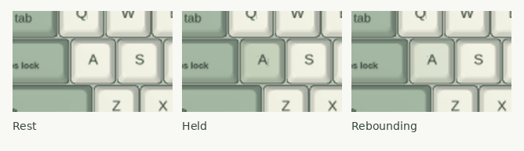

# 俯視鍵帽與懸浮小窗實測

在雲端桌面版 Chromium 156.0.8078.79 測試原有 GitHub Pages 網址。修復前版本為 `562c8c1`，修復後的網站程式為 `1957047`。首頁及 17 個執行資源的正式 HTTPS 回應與提交內容逐一比對，SHA-256 全部相符。[正式網站](https://annecat-bit.github.io/sage-keys/) · [修復差異](https://github.com/AnneCat-bit/sage-keys/compare/562c8c1...1957047) · [Pages 部署](https://github.com/AnneCat-bit/sage-keys/actions/runs/44908095629)

## 三個問題如何重現

| 問題 | 修復前的操作與觀察 | 源碼修正 |
| --- | --- | --- |
| 俯視鍵程 | 正交相機沿著下沉方向觀看。固定相機、同一 1014 × 370 畫布按住 A，只有 58 個像素的任一 RGB 色頻差值達 8/255。鍵帽頂點有移動，俯視幾乎看不出。 | 保留幾何鍵程，按深度柔和改變該鍵帽的頂點顏色。按住時顏色維持，回彈時還原。沿用現有單鍵局部重繪及五次 draw call，沒有加入燈光、陰影計算或待機動畫。 |
| 小窗敲擊與音效 | 用滑鼠取消靜音後，焦點仍在按鈕，下一次 Space 又觸發靜音。將真實解碼結果延後 400 ms 交回，舊版的 160 ms 截止會捨棄首聲。舊版在音檔已預熱時，部分小窗操作能正常發聲。 | 點按小窗控制後，焦點交回鍵盤區。鍵盤操作控制項保留原生焦點。開窗時先利用使用者手勢啟動音訊，冷啟動最多保留最近一擊。兩個文件的失焦事件延後核對，已送達的可信實體鍵事件喚醒模型。排程跟隨畫布所在視窗，回彈使用同一時鐘，移入、移出及恢復可見時重畫。 |
| 省電狀態 | 小窗切到標準，再從主頁改回省電，主頁為 eco，小窗的 `aria-pressed` 仍為 false。小窗一直顯示「省電」。 | 兩個入口共用設定更新。小窗文字直接顯示目前的「省電模式」或「標準模式」，省電有填色，提示及讀屏狀態同步更新。新使用者預設省電。 |

## 影格、聲音與輸入

使用有視窗管理器的 Chromium，在原生 Document Picture-in-Picture 視窗及主頁間實際切換前景。透過 DevTools 連接瀏覽器既有 context，保留真實的焦點、分頁可見性及音訊手勢要求。雲端 HTTPS 代理使用系統 CA 驗證並將正式站回應交給 Chromium。鍵盤事件由瀏覽器派送。測試讀取 WebGL 像素、音源啟動參數及壓縮器後的 PCM。表內的峰值來自測試實際讀取的訊號區間，單位為相對數位滿刻度振幅。量測程式只在測試瀏覽器注入。[逐次事件、影格與聲音數據](interaction-evidence.json) · [測試程式](../tests/interaction.py)

| 正式站操作 | 觀察到的結果 |
| --- | --- |
| 立體、俯視各按住 A、S、Space、Enter 再放開 | 立體四鍵按住時分別有 1,171、1,176、8,987、2,495 個像素達門檻。俯視分別有 1,397、1,432、9,279、3,162 個。俯視 A 只重畫 47 × 50 區域。八次均有中間回彈影格，最後整張畫布的 RGB 與各自按下前完全相同。 |
| 俯視 A 的逐幀變化 | 對每個像素取最大色頻差值，再於局部重繪區加總。由按到底至復位依序為 54,619 → 54,186 → 26,230 → 7,734 → 601 → 0。首幀達門檻的像素為舊版的約 24 倍。 |
| 立體、俯視各連打兩輪 A、S、Space、Enter | 每個視角各收到 8 個可信 keydown 和 8 個 keyup，各啟動 8 個錄音。分別觸發 35、45 次 WebGL draw call。書寫區的字母、空格、換行及插入位置均與預期相符。 |
| 主頁書寫、小窗繪製 | 主頁 textarea 有焦點，小窗可見且無焦點。按住 S 在 400 × 250 小窗改變 324 個像素，回到靜止時為 0。連打 8 鍵有 8 個錄音、40 次 draw call，PCM 峰值 0.506。 |
| 在小窗打字及返回 | 小窗省電及標準各打 8 鍵，各有 8 個錄音，分別繪製 50、75 次。切至另一分頁使主頁真正 hidden，再讓小窗取得焦點，Enter 改變 688 個像素，8 鍵仍得到 8 個錄音。返回主頁後比對同一個 canvas 與 WebGL context，context 未遺失，再打 8 鍵得到 8 個錄音及 40 次繪製。 |
| 第一次開窗、靜音及取消靜音 | 新文件以開窗作為第一個手勢，小窗首擊啟動一個運作中的錄音，PCM 峰值 0.420。刻意延後首個解碼結果 400 ms 的獨立測試也有錄音，峰值 0.439。靜音後按 Space 得到 0 音源、PCM 峰值 0。取消靜音後立即按 Space 啟動 Space 取樣，峰值 0.439。 |
| 三種音色試聽 | 小窗開啟期間從主頁選擇音色並試聽。Rainy 75、HHKB Topre、Cherry MX Brown 的解碼緩衝區長度分別為 30,825、33,075、32,942 個取樣，實際混音峰值分別為 0.439、0.321、0.420。 |
| 畫質同步 | 由預設省電，依次經小窗、主頁、主頁、小窗切換，兩處讀值同為「省電 → 標準 → 省電 → 標準 → 省電」。每步檢查文字及按鈕按壓狀態，兩種畫質均有實際按鍵繪製及錄音。 |
| 中文、焦點與閒置 | 透過 Chromium IME 介面提交「你」「好」，取消第三段組字，得到三對 compositionstart／compositionend，文字恰為「你好」。在其他分頁輸入時，小窗保持可見，新增繪製與音源均為 0。主頁隱藏、小窗打字完畢後亦確認 AudioContext 進入 suspended。 |

## 修復前後的資源用量

在相同雲端環境以另一個專用 Chromium 程序量測，關閉上述像素及 PCM 探針。使用 ANGLE SwiftShader 軟體繪圖，主視口 1280 × 800、畫布 1150 × 414、DPR 1，小窗內容 400 × 250。每段約八秒，有聲輸入情境每秒交替按 A、S 八次，共 64 擊。CPU 採瀏覽器各程序的 CPU 時間增量，100% 等於一個核心。PSS 是整組瀏覽器程序的比例分攤記憶體，含軟體 GPU。[量測程式](../tests/benchmark.py) · [完整數據及 JS heap](interaction-performance.json)

| 情境 | CPU 修復前 → 後 | PSS MiB 前 → 後 | 新繪幀數前 → 後 | 平均 fps 前 → 後 |
| --- | ---: | ---: | ---: | ---: |
| 空白瀏覽器 | 1.24% → 2.12% | 211.3 → 262.4 | 0 → 0 | 0.00 → 0.00 |
| 主頁省電靜置 | 0.87% → 0.87% | 393.4 → 447.9 | 0 → 0 | 0.00 → 0.00 |
| 主頁省電打字 | 253.90% → 252.58% | 380.6 → 435.4 | 235 → 240 | 29.28 → 29.91 |
| 主頁標準打字 | 375.47% → 377.57% | 385.3 → 440.9 | 426 → 457 | 53.05 → 56.95 |
| 主頁停止輸入後 | 7.60% → 0.50% | 384.1 → 439.8 | 0 → 0 | 0.00 → 0.00 |
| 小窗省電靜置 | 1.37% → 1.25% | 380.3 → 436.6 | 0 → 0 | 0.00 → 0.00 |
| 小窗省電打字 | 95.84% → 95.68% | 377.2 → 434.7 | 241 → 236 | 30.04 → 29.44 |
| 小窗停止輸入後 | 1.48% → 0.37% | 375.3 → 431.9 | 0 → 0 | 0.00 → 0.00 |

最終版小窗連打時的整組瀏覽器 PSS 為 434.7 MiB，修復前為 377.2 MiB。兩次空白瀏覽器的起點亦由 211.3 升到 262.4 MiB。分別減去各自空白起點，小窗的差額為 165.9 與 172.3 MiB。前一次正式站量測（補修二維模式前）的小窗為 380.5 MiB、92.03% CPU、30.05 fps。

主頁與小窗的靜置、停止輸入四個測量區段，各自新增 0 幀。另於有焦點的小窗停止打字，待音訊暫停後再觀察 500 ms，兩個文件均沒有新增 animation frame 請求。持續打字仍需繪畫和播放錄音。這些短時間樣本受排程、軟體繪圖及瀏覽器記憶體回收影響。

開發過程亦比較了小窗焦點的放置方式。在雲端軟體繪圖上，將焦點交回小窗文件、只在下方控制列標示焦點，可避免為畫布加上覆蓋整個視窗的焦點外框。定稿前在 400 × 250 的小窗交替測量，兩輪各六秒、48 擊、48 個音源，這個做法分別量得 91.75% 與 92.61% CPU，兩次均繪製 181 幀。相鄰的原版樣本為 97.23%、181 幀。正式站的完整八秒量測列於上表。省電與標準的動畫上限仍為 30 及 60 fps。

## 其餘回歸與平台限制

- 既有兩套回歸也對正式站執行。多鍵與修飾鍵、瀏覽器編輯捷徑、三個 WAV 錄音庫、五音源上限、旋轉縮放、重新整理及 WebGL 停用時的二維鍵盤均通過。小窗支援返回、原生關閉及調至 300 × 190，主頁重新整理後可正常載入。[工作室測試](../tests/studio.py) · [懸浮測試](../tests/floating.py)
- 停用 WebGL 的二維降級測試曾在固定等待 220 ms 後仍見按下狀態。改量實際解除時間後，兩次舊行為為 208.9、357.3 ms。現以 keyup 直接解除，正式站量得 0.6 ms，並確認瀏覽器的 105 ms 回彈動畫結束後回到原位。
- 小窗音量按鈕也經鍵盤操作驗證。Tab 可移到按鈕，Space 靜音、Enter 取消靜音，焦點保留。滑鼠操作後則可直接敲 Space，沒有再次切換按鈕。
- 測試檔中的按鍵、組字和焦點紀錄均來自自動化測試案例。工作室程式沒有載入這些探針。鍵盤事件只在工作室及其小窗中接收。
- Chromium IME 協定覆蓋組字、提交、取消及文字結果。macOS 實體倉頡、速成、拼音候選窗，Mac 喇叭可聞音色與端到端延遲、硬體 GPU 功耗、溫度及電池續航仍待實機驗證。Word 或其他 App 的按鍵同步仍屬獨立原生版的研究方向。[原生版評估](MACOS-FEASIBILITY.md)
