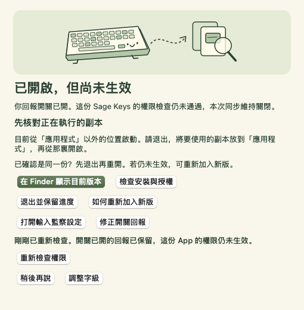

# Sage Keys for Mac v0.2.2 · 開關已開，仍無法同步

**已確認同一路徑的 ad-hoc 更新可以改變 macOS 用來核對程式的簽署要求。** 這能解釋一種更新後的失效情況。你的設定列表記住了哪一份 App、是否需要重開程序，以及裝置政策有沒有影響，仍須由你在該部 Mac 核對。v0.2.2 會先採信你看到的開關狀態，再顯示執行中程序的權限讀數，兩者可以同時成立。[下載 Apple Silicon 個人測試版](https://github.com/AnneCat-bit/sage-keys/actions/runs/44922576387/artifacts/14714312538) · [成功編譯及完整 Log](https://github.com/AnneCat-bit/sage-keys/actions/runs/44922576387) · [相對 v0.2.1 的原始碼 Diff](https://github.com/AnneCat-bit/sage-keys/compare/daf1c3ac952e148a5a7492ada7c1ae3ac5371c6c...562467ab5f013036b2bbe15f800e6d944bad637d)

## Finder 更新與恢復

1. 從舊版的選單列鍵盤圖示選「退出 Sage Keys」，等圖示消失。紅色關閉鍵會保留舊程序。
2. 登入 GitHub，下載上方 Artifact。在 Finder 解開外層 ZIP，再解開裡面的 **Sage-Keys-arm64.zip**。將 **Sage Keys.app** 拖到「應用程式」並選「取代」，由該處打開。原來的已信任 App 名單會保留。
3. 選鍵盤圖示 →「檢查安裝與授權」。核對 **0.2.2 (4)**、路徑及 Bundle ID；「在 Finder 顯示目前版本」會選中正在執行的 App。返回導覽，選「開關已開，仍無法同步」。
4. 若來自下載或暫時位置，先安裝並從「應用程式」啟動。已經是正確的副本時，按「退出並保留進度」，再從 Finder 開啟同一份 App。按「重新檢查權限」。系統若已給這個程序權限，可進入確認。
5. **重開後仍無效**，選「如何重新加入新版」。打開輸入監察，手動選取已失效的 **Sage Keys** 舊項並按「−」，再按「＋」選剛才在 Finder 核對的那份 App，親自批准。按 macOS 提示退出並重新開啟。若公司管理政策鎖定控制，可將本地診斷畫面給管理員核對。
6. 確認畫面顯示「macOS 已授權」後，按「確認並開始本次同步」，切回已批准的目標 App。一開始只選「本次允許」的舊程序若已結束，需要重新選取目標。已勾選記住的待辦保留原目標的身分與簽署要求。

這是未經 Developer ID 簽署或公證的 Apple Silicon 個人測試版，最低部署目標為 macOS 13。Gatekeeper 對這份 ZIP 解出的 App 評估為 rejected。只在已核對來源、主動決定測試且系統提供選項時，使用 Apple 的單一 App 核准流程；執行許可和輸入監察是兩個獨立決定。[Apple 的單一 App 核准說明](https://support.apple.com/zh-hk/guide/mac-help/mh40616/mac) · [打包簽章檢查](evidence/v0.2.2/gatekeeper.txt)

## 權限與身分的調查結果

- v0.2.1 的程式丟棄了 CGRequestListenEventAccess 的布林結果。當 Core Graphics 預檢不通過且 IOHID 回報 denied，舊介面直接顯示拒絕，也沒有列出執行中的路徑或簽署要求。遺失請求結果影響的是診斷，不能由此推定 macOS 為何拒絕。
- 在同一台標準 macOS ARM Runner，將 v0.2.1 已發布的 App 和本次 ZIP 依次放到同一安裝路徑，兩者各自通過嚴格簽章完整性驗證。Bundle ID 均為 io.github.annecat-bit.sagekeys，均沒有 Team ID。v0.2.1 的指定簽署要求使用 CDHash `b7656eeb2a6f5ee2bf4c7eeb18aaced7325780e9`，本版使用 `164c173d3c302acf5c208282dd46e5565b314ffb`。舊版符合它自己的要求；以同一要求核對新版失敗。這是對兩個實際成品的驗證，沒有更改或讀取 TCC 資料庫。[同一路徑替換 Log](evidence/v0.2.2/update-identity.log) · [Apple 簽署要求說明](https://developer.apple.com/documentation/technotes/tn3127-inside-code-signing-requirements)
- App 即時顯示 CGPreflightListenEventAccess、IOHIDCheckAccess (ListenEvent)，以及本次程序最後一次 CGRequestListenEventAccess 的實際回傳或「本次程序未請求」。設定回來、重新檢查及開始前會重新讀取。只有 Core Graphics 實際回報有效，才進入成功畫面。若之後連唯讀事件通道也無法建立，會停止並顯示另一個診斷原因。
- 「開關已開」來自使用者親眼觀察。診斷核對目前 bundle 路徑、版本、簽章完整性、指定要求、磁碟身分、Launch Services 已知副本及兩個標準應用程式目錄中的同名副本。macOS 可能合併相同副本的登記；清單未列出副本不能證明磁碟上只有一份。安裝檢查按需執行，不搜尋私人文件、下載目錄，不監看設定頁。
- 已有的信任清單與系統授權分開保存。新版本可在本機比較上次有效的 build 和已記住的簽署雜湊；首次從 v0.2.1 更新可能只有 build 或完全沒有基準。App 不會推測舊資料。重開只接續導覽，不會啟動跨 App 監測。產品沒有新增網絡請求、輔助使用權限、逐鍵輸入紀錄或背景診斷計時器。[Apple 輸入監察指引](https://support.apple.com/zh-hk/guide/mac-help/mchl4cedafb6/mac)

## 實際原生畫面

以下是從 AppKit 執行中的導覽擷取的內容區。QA 在沒有全域事件來源的情況下控制權限讀數，以便拍攝不同畫面。「成功」圖說明介面反應，M2 的實際授權仍由 macOS 決定。

| 畫面 | 操作 |
| --- | --- |
| [A · 核對權限](evidence/v0.2.2/guide-status.png) | 選擇你親眼看到的開關狀態。 |
| [B · 系統設定入口](evidence/v0.2.2/guide-settings.png) | 直達輸入監察，或從私隱與保安進入。 |
| [C · 已開啟，但尚未生效](evidence/v0.2.2/guide-repair.png) | 核對副本、退出並保留進度、重新檢查。 |
| [重新選取新版](evidence/v0.2.2/guide-replace.png) · [安裝與授權讀數](evidence/v0.2.2/guide-installation.png) | 先找出正在使用的版本，再處理舊項。診斷截圖顯示 Runner 的 QA 路徑和身分。 |
| [D · 權限通過](evidence/v0.2.2/guide-success.png) | 使用者再確認本次同步。 |

## 實際驗收及範圍

| 測試 | 執行結果 |
| --- | --- |
| 原生 App 與真實 OS | 在 Version 15.8.2 (Build 24H232) 解開 arm64 成品、驗證簽章並啟動。QA 在同一圖形工作階段讀到 Core Graphics 預檢 **false**、IOHID **unknown**，未向系統請求授權。實際副本測試將另一份相同 Bundle ID 的 App 安裝在 Runner 的使用者 Applications，診斷找到了它。 |
| 模擬權限與原生按鈕 | 通過首次允許、拒絕、不確定、已授權、回報開關為開但雙 API 未核准、IOHID 已允許但 CG 仍拒絕，以及 CG 已允許但通道建立失敗。這些測試使用沒有系統鍵盤事件來源的替身；按鈕、視窗及 AppKit 事件皆走實際程式路徑。[同意與矛盾狀態](evidence/v0.2.2/guide-draft.json) |
| 退出與重開 | 以不同 PID 實際退出和重開。新程序保留原目標及回報的開關狀態，重新檢查仍未監測。模擬權限生效後，切回導覽觸發重查；手動確認只允許原來的 Calculator。換成不符合指定簽署要求的待辦時驗證拒絕。[恢復](evidence/v0.2.2/guide-restored.json) · [簽署不符](evidence/v0.2.2/guide-mismatch.json) |
| 視窗、鍵盤導航與文字縮放 | 各圖解頁在 356 和 640 點寬驗證文字與按鈕可完整顯示或捲到；矛盾頁在 356 × 295 和 640 × 600、150% 字級重測。以視窗內的 Tab／Shift-Tab 事件驗證實際焦點正反向移動。標題放大到 34.5 pt。 |
| VoiceOver | Runner 以既有 QA 輔助使用權限從外部讀取真實 AX 樹，能辨識畫面標題、「重新檢查權限」按鈕及插畫替代描述。Runner 啟動 VoiceOver 的嘗試結果為 `launch requested`，系統 isVoiceOverEnabled 為 **false**；沒有人工語音聆聽驗收。[輔助功能證據](evidence/v0.2.2/guide-accessibility.json) |
| 系統設定入口 | 在 macOS 15.8.2 與 26.7.2 以只讀測試工具核對系統設定的實際視窗標題或該頁專屬說明，兩者皆到達 Input Monitoring 和 Privacy & Security。13、14 沿用手動備援，這次未取得這兩個版本的 Runner。[設定頁 Log](evidence/v0.2.2/settings-links.log) |
| 桌寵與正式網頁 | 16 組原生回歸通過。單一 WebGL context，兩鍵壓下、單鍵保留、全部放開時，與靜止參考圖相差 2768、326、0 像素。三組真實錄音均有非零混音輸出。已批准 App 切換、Secure Event Input、停用、退出資源釋放與離線封鎖正常。公開 Pages 經 HTTPS 的工作室及小窗互動測試通過。[原生數據](evidence/v0.2.2/mac-results.json) · [正式網站](evidence/v0.2.2/pages-web.log) · [懸浮小窗](evidence/v0.2.2/pages-pip.log) |

## 資源使用

在同一台 Runner 順序實際開啟兩份發行包內的授權導覽，用只讀 AX 確認視窗可見、靜置兩秒，再取 12 次進程數據。CPU 為 CPU 時間差 / 實際牆鐘時間，100% 代表一個核心，RSS 為主程序樣本中位數，這組數據不包含 WebKit。v0.2.1 量測 8.2 秒，v0.2.2 量測 8.4 秒。[兩版成品同機量測](evidence/v0.2.2/update-identity.log)

| 授權導覽閒置 | v0.2.1 | v0.2.2 |
| --- | ---: | ---: |
| 主程序單核 CPU | 0.24% | 0.12% |
| 主程序 RSS | 90.1 MiB | 87.1 MiB |

下表採兩版各自編譯的 QA Runner，以相同腳本採樣同一圖形工作階段中新出現的 WebKit 服務及 App 主程序。CPU 依間隔加權，RSS 為合計的中位數（可重複包含共用頁）。短測有排程誤差，不宜從小幅差距推算實機耗電。[v0.2.1 原始 CSV](evidence/v0.2.2/process-v0.2.1.csv) · [v0.2.2 原始 CSV](evidence/v0.2.2/process.csv)

| 場景 | 單核 CPU，舊 → 新 | 合計 RSS，舊 → 新 |
| --- | ---: | ---: |
| 已信任 App 閒置 | 0.00% → 1.87% | 196.2 → 367.6 MiB |
| 未信任 App 待命 | 0.26% → 0.00% | 196.0 → 367.6 MiB |
| 省電 15 FPS，24 次模擬敲擊 | 13.30% → 12.09% | 201.3 → 296.2 MiB |
| 標準 30 FPS，24 次模擬敲擊 | 16.75% → 15.44% | 204.8 → 293.7 MiB |
| 敲擊後靜止 | 0.69% → 1.23% | 205.7 → 293.6 MiB |

新版這次「已信任 App 閒置」的合計 RSS 高於以前。採樣器在舊版納入 3 個 WebKit 服務，新版這次納入 8 個。同一提交在另一台 Runner 重測時納入 3 個，合計約 245.4 MiB，舊版約 196.2 MiB。這個採樣方式無法精確歸屬共用的 WebKit 記憶體；實機常態佔用仍需觀察。[同一提交的第二次 CSV](evidence/v0.2.2/process-repeat.csv) · [第二次成功執行](https://github.com/AnneCat-bit/sage-keys/actions/runs/44922576440)

新版卡通圖解閒置 4 秒共重畫 **0 次**。鍵盤靜止 2.3 秒，WebGL 繪圖 0 次、要求動畫影格 0 次，音訊狀態為 suspended。未量度 M2 實機 GPU 能耗、溫度、電池使用時間或長時記憶體曲線。

## 原始碼及成品

[InstallationCheck.swift](Sources/InstallationCheck.swift) 負責安裝身分與權限讀數。[KeyMonitor.swift](Sources/KeyMonitor.swift) 和 [PetApp.swift](Sources/PetApp.swift) 處理實際請求、狀態轉換、重查與監測失敗。[PermissionGuide.swift](Sources/PermissionGuide.swift) 和 [GuideDrawing.swift](Sources/GuideDrawing.swift) 提供可操作的原生導覽。版本資訊在 [Info.plist](Info.plist)，兩個成品的簽署與資源比較在 [GitHub Actions 工作流程](../.github/workflows/sage-keys-macos.yml)。

已重新下載成品核對 ZIP 完整性、SHA-256、arm64 執行檔、0.2.2 (4) 及 13 個離線檔案雜湊。這些模型、音效打包程式、字型及授權檔與 v0.2.1 逐項一致。QA 工具沒有打進下載成品。[離線資產清單](evidence/v0.2.2/bundled-sha256.txt)

## M2 MacBook 實機驗收

- [ ] Finder 更新後從「應用程式」打開，版本顯示 0.2.2 (4)，路徑正確；原來的已信任清單仍在，同步為關閉。
- [ ] 對照藍色開關與診斷的 CG／IOHID 讀數。在未獲有效權限時，於 Word 或 TextEdit 按鍵應沒有回饋。
- [ ] 退出並保留進度、重開同一份 App。若仍失效，再手動重新加入核對過的副本及依系統提示重開；記下哪一步後 CG 預檢首次變為 true。如果仍為 false，保留版本、是否在「應用程式」、兩個 API 讀數及是否發現其他副本作後續核對。
- [ ] 顯示「macOS 已授權」後先保持關閉，手動確認才在已信任 App 看到鍵帽、聽到錄音；未信任 App、暫停以及下一次重開均不應啟動監測。
- [ ] 以慣用的中文 VoiceOver 聆聽新狀態、箭嘴插畫替代描述及按鈕；用 Tab、Shift-Tab 及放大字級操作完整流程。再以「活動監視器」觀察長時間使用時的能耗。

[Apple 的輸入監察設定](https://support.apple.com/zh-hk/guide/mac-help/mchl4cedafb6/mac) · [可重新下載的原始測試 Artifact](https://github.com/AnneCat-bit/sage-keys/actions/runs/44922576387/artifacts/14714755833) · [內層 ZIP 的 SHA-256](evidence/v0.2.2/SHA256.txt) · [程式、測試與打包 Diff](https://github.com/AnneCat-bit/sage-keys/compare/daf1c3ac952e148a5a7492ada7c1ae3ac5371c6c...562467ab5f013036b2bbe15f800e6d944bad637d)
