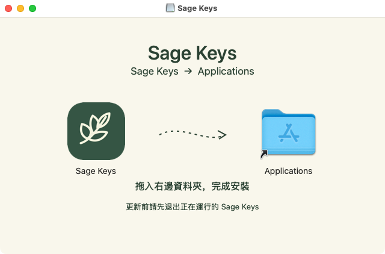

# v0.2.4 · Finder DMG 安裝

**改用可直接下載的 DMG，安裝狀態與輸入監察分開處理。** 原有模型、錄音、離線網頁資產及 GitHub Pages 程式碼未改動。這是 ad-hoc 簽署的 Apple Silicon 個人測試版，未經 Developer ID 簽署或 Apple 公證。

[直接下載 DMG](https://github.com/AnneCat-bit/sage-keys/releases/download/v0.2.4/Sage-Keys-Apple-Silicon.dmg) · [下載頁](https://github.com/AnneCat-bit/sage-keys/releases/tag/v0.2.4) · [編譯及完整 log](https://github.com/AnneCat-bit/sage-keys/actions/runs/44979295414) · [源碼 Diff](https://github.com/AnneCat-bit/sage-keys/compare/a907efdf7fb009a6355ca26a47532cafbe2d9d3d...60f9410429e6fb182f1f1424a783d385f2ce07dc)

## 改動及原因

原有下載方式需要解開 Actions 外層 ZIP，再解開 App ZIP；未提供 Finder 的安裝目標。v0.2.3 雖能顯示實際路徑，啟動時仍可能讓未安裝的程序直接進入同步和權限流程。本次修正這兩個可核實的流程問題；不能據此判定使用者的 TCC 記錄為何失效。

- `Packaging/dmg.sh` 使用 macOS 內置 `hdiutil` 產生唯讀壓縮 DMG，內容為 Sage Keys.app、指向 `/Applications` 的捷徑及靜態背景。`layout.applescript` 保存 Finder 圖示位置，背景由小型 AppKit 程式繪製，沒有第三方安裝工具。
- `PetApp.swift` 在初次載入、Finder 重新開啟及同步入口，重新建立 `InstallationCheck`，取得當前程序路徑、簽署及同 Bundle ID 的其他運行程序。正確安裝、沒有其他程序、磁碟與啟動身分未發現衝突後，才可進入原有同步流程。
- `InstallNotice.swift` 將不合適的執行位置、同時運行的另一份程序、磁碟與程序不同分開提示。它不要求 Input Monitoring、不搬移檔案、不終止其他程序。可關閉或按「先試用鍵盤」，繼續離線模型與試聽。
- 安裝完成後不自動開權限導覽，也不自動恢復同步。信任清單與未完成的選擇維持保存。每次啟動依然需要手動開始本次同步。

若 Finder 把開啟要求交回仍在運行的**舊版**，尚未啟動的新版無法改變舊版的處理；更新前完全退出舊程序仍是必要步驟。新版本身不會強制結束其他 App。

## 可重現的雲端驗收

來源提交 `60f9410429e6fb182f1f1424a783d385f2ce07dc`，版本 **0.2.4 (6)**。標準 GitHub-hosted `macos-15` Apple Silicon Runner，實際 macOS 15.8.2、Xcode 16.4、Swift 6.1.2，唯讀 repository 權限；沒有付費大型 Runner。2026-11-22 香港時間完成，Actions 全部必需工作成功。`Tests/dmg.sh` 與 `Tests/DMG/main.swift` 會拒絕覆蓋已有的安裝，只在專用 Runner 操作測試副本。[編譯摘錄](evidence/v0.2.4/build-excerpt.txt)

| 實測步驟 | 證據與界線 |
| --- | --- |
| 建立、驗證及重新掛載最終 DMG | hdiutil verify 通過。重新掛載最終 UDZO 映像，確認 Applications 符號連結實際指向 `/Applications`，簽章嚴格驗證通過。 |
| Finder 真實版面及拖放 | 透過 AX 讀取兩個圖示的螢幕位置，以鼠標事件從 App 拖到 Applications，沒有檔案複製後備途徑。上圖是最終 DMG 的 Finder 視窗截圖。 |
| 從下載資料夾及映像啟動 | 測試副本由 Launch Services 啟動，出現安裝提示，沒有直接出現權限導覽。下載資料夾為 Runner 測試目錄，並非瀏覽器下載後的隔離標記測試。 |
| 另一份程序尚在運行 | 映像中的程序保持運行，再明確啟動安裝副本；新程序顯示舊 PID 並阻止進入授權流程。測試確實退出兩個程序，才卸載 DMG。 |
| 卸載後重新開啟 | `/Applications/Sage Keys.app` 正常顯示鍵盤，沒有安裝提示或自動權限導覽。透過真正 App 的診斷畫面取得 proc_pidpath、版本、ad-hoc 身分、系統權限回報，同步保持關閉。 |
| 安裝內容完整性 | 對編譯 bundle 與 Finder 安裝後 bundle 的全部 17 個檔案逐一比對 SHA-256、檔案 mode、符號連結目標，完全一致；再次驗證簽章通過。 |
| 個人 Applications | 同一成品複製至 Runner 使用者的 Applications 後可啟動，未顯示安裝位置錯誤。 |

[逐步事件紀錄](evidence/v0.2.4/dmg-lifecycle.log) · [檔案完整性比對](evidence/v0.2.4/dmg-integrity.json) · [安裝位置提示截圖](evidence/v0.2.4/install-location.png) · [已安裝程序診斷截圖](evidence/v0.2.4/installed-diagnostic.png)

DMG 為 **791,445 bytes**，SHA-256：`1d2ad40b690ef0e3cc4269ae02174fe8b74a8d78484c8032dd296ca68155e8dc`。[校驗檔](evidence/v0.2.4/DMG-SHA256.txt) · [原始 DMG Artifact](https://github.com/AnneCat-bit/sage-keys/actions/runs/44979295414/artifacts/14737062804) · [完整測試 Artifact](https://github.com/AnneCat-bit/sage-keys/actions/runs/44979295414/artifacts/14736609413)

## 原有功能回歸

16 組原生回歸全部通過，另有退出重啟、授權流程及無障礙檢查。以下明確區分真實系統行為與模擬事件，沒有在雲端代替使用者批准 TCC。[原始結果](evidence/v0.2.4/mac-results.json) · [測試 log](evidence/v0.2.4/native-tests.log)

| 項目 | 實際觀察 |
| --- | --- |
| 真實安裝後的權限 | 成品 PID 6296 自己回報實際執行檔在 `/Applications`，簽署檢查 OSStatus 0，CGPreflight 為 false、IOHID 為 unknown、本次未呼叫請求 API。這證明安裝已正確與權限未通過可以同時存在。 |
| 拒絕、開關已開但未生效、恢復 | 使用測試限定替身回報 denied／不一致／後來 granted；拒絕時不啟動 tap、保留已確認目標；重新開啟後不自動同步。這是受控情境，沒有改寫 TCC。[授權測試](evidence/v0.2.4/guide-draft.json) · [重開續辦](evidence/v0.2.4/guide-restored.json) |
| 目標簽署不符 | 系統權限模擬有效時，目標 designated requirement 不符仍被拒，原信任清單保留。[證據](evidence/v0.2.4/guide-mismatch.json) |
| 紅色關閉／重開／退出 | 真實 AppKit close 與 reopen callback，維持同一 panel、PID、WebGL context。關閉前按壓像素差 396，恢復後 0，沒有卡鍵；兩次不同程序啟動皆預設關閉同步。 |
| 3D 與聲音 | 真實 WKWebView 加模擬鍵位狀態：兩鍵／單鍵／回彈的像素差為 2768／326／0。三個 WAV 解碼並播放，Web Audio running，混音峰值 Rainy 0.457、Topre 0.393、Brown 0.308。 |
| 離線、隱藏及釋放 | bundle file 載入，App fetch 0；隱藏後新增繪圖及音源 0。退出後 AudioContext closed、WebGL lost、WKWebView 與原生顯示控制器均釋放。 |
| 系統設定入口 | 在獨立 macOS 15.8.2 及 26.7.2 Runner 實際開啟「輸入監察」，以 AX 讀到目標頁面標題或說明文字，沒有只憑 URL 成功回傳判定。 |
| 網頁版 | 正式 Pages 的 18 個 HTML／CSS／JS／字型／錄音等資源重新 HTTP 讀取並核對 SHA-256，一致；本次未改動網頁源碼。 |

沿用 `Tests/processes.py` 讀取 QA 原生程序及新出現的三個 WebKit 服務。CPU 以 ps 累積時間按取樣區間加權，100% 代表一核心；RSS 為區間中位數，WebKit 合計可能包含共享記憶體。

| 情境 | 原生 CPU | WebKit CPU | 原生 RSS MiB | WebKit RSS MiB |
| --- | ---: | ---: | ---: | ---: |
| 靜置 | 0.31% | 1.26% | 85.5 | 130.3 |
| 15 FPS 模擬敲擊 | 1.50% | 9.72% | 85.5 | 126.6 |
| 30 FPS 模擬敲擊 | 1.51% | 12.99% | 85.5 | 129.7 |

樣本只有約 2.7–3.3 秒，不等於 M2 的長期耗電或 GPU 功率。新舊版相同的 2.3 秒靜置檢查均為 0 draw call、0 動畫請求。新版 24 次模擬敲擊在約 3.5 秒分別畫 45 幀／91 幀；保留單一 WebGL context。安裝檢查沒有新增持續輪詢。[CSV](evidence/v0.2.4/process.csv) · [統計值](evidence/v0.2.4/process-summary.json)

## 安裝與授權界線

DMG 內與 Finder 安裝後的 App 是同一個簽署成品，打包和拖放沒有改變其身分。**更新程式內容會改變 ad-hoc CDHash；標準 DMG 不會讓舊 TCC 授權自動適用新版。** 相同名稱、Bundle ID 或路徑不等於已具有穩定的跨版本授權身分。v0.2.3 的 CDHash 是 `8c93e04607247a2d08cb19db2cc28aea5db41975`，本次變為 `2efe300f287052b61c7bc455d02e6f7153e22a5f`；成品診斷讀到 designated requirement 仍是指定 CDHash。舊版本間已實測到新版不符合舊版的指定簽署要求，[紀錄](evidence/v0.2.3/signing.log)仍適用這項限制。

本次 `codesign --verify --deep --strict` 通過，但 `spctl` 評估仍為 **rejected，exit 3**，沒有 Developer ID 或公證；不能把在 Runner 啟動等同於 Gatekeeper 正式發行核准。[完整簽署及評估](evidence/v0.2.4/gatekeeper.txt)

對外正式發行通常需要同一開發者團隊的 Developer ID 簽署與相容的 designated requirement，另辦理 Apple 公證。這次未購買或使用這些服務。公證也不等於輸入監察授權，最後仍由 macOS 和使用者決定。程式未讀寫 TCC 資料庫、未重設權限、未解除 quarantine，也未改動 Gatekeeper 或 SIP。

Runner 的啟動不能代表瀏覽器下載後的 Gatekeeper／AppTranslocation 行為。尚未在使用者 M2 重現「系統開關開啟、CGPreflight 卻拒絕」的矛盾，**不宣稱更新本版即可恢復跨 App 同步**。如系統仍未通過，原有離線預覽及聲音可以繼續使用。

## Finder 更新及 M2 驗收

1. 從舊版選單列選「退出 Sage Keys」，等圖示消失。下載 DMG，雙擊掛載。
2. 在安裝視窗把 Sage Keys 拖到 Applications；由 Finder 詢問是否取代時自行確認。完成後退出磁碟映像。
3. 從「應用程式」開啟。應顯示鍵盤及「同步已關閉」，沒有要求重複搬移的循環。
4. 透過「檢查安裝與授權」核對版本 0.2.4 (6)、實際執行檔 `/Applications/Sage Keys.app/Contents/MacOS/SageKeys`、沒有其他同 ID 程序；安裝狀態和系統權限分開顯示。個人 Applications 亦是支援位置。
5. 手動選擇需要同步的 App。只有系統 API 真正通過、目標身分驗證及本次確認完成後才開始同步。M2 需要實際驗證更新後 TCC、Gatekeeper、退出重開、拒絕時仍可試敲，以及 TextEdit／Word／Chrome 的鍵位與音效。

整條驗收均可透過 Finder、App 和系統設定操作，無需 Terminal。若 Gatekeeper 不提供安全的單一 App 核准途徑，停止安裝；不要關閉系統保護。[完整安裝指引](README.md)
