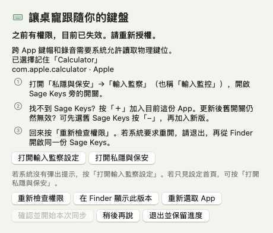

# Sage Keys for Mac v0.2.1 · 輸入監察授權導覽

**Apple Silicon 個人測試版，最低 macOS 13。** v0.2.0 在讀取「記住此 App」之前請求系統權限，遇到權限不足便返回桌寵。v0.2.1 先保存使用者選擇，再處理系統授權，並提供可直接操作的原生導覽。[下載 App](https://github.com/AnneCat-bit/sage-keys/actions/runs/44919307464/artifacts/14713056452) · [完整 Actions log](https://github.com/AnneCat-bit/sage-keys/actions/runs/44919307464) · [原始驗收 Artifact](https://github.com/AnneCat-bit/sage-keys/actions/runs/44919307464/artifacts/14712454566) · [相對 v0.2.0 的程式碼 Diff](https://github.com/AnneCat-bit/sage-keys/compare/16929783a91c4ddc38d469e70377dc742c332b97...6357ba10eef07a4e52f30eb440cb25db75c53d95)

## 更新與使用

1. 從選單列鍵盤圖示選「退出 Sage Keys」。在 Finder 解開下載的 Artifact ZIP，再解開內層 Sage-Keys-arm64.zip。將新版拖到「應用程式」，選「取代」。
2. 打開新版，切到目標 App，按桌寵「同步」。核對目標並選擇是否記住，再按「允許並開始同步」。若已有已信任 App，直接按「同步」即可走權限檢查。
3. 若 macOS 詢問，請親自選擇。若沒有提示，導覽的「打開輸入監察設定」可直接跳轉。於清單開啟 **Sage Keys 自己**的開關。新項目未出現時可按「＋」，或用導覽的「在 Finder 顯示此版本」找出正在執行的副本。若更新後舊項目已經無效，導覽也有移除舊 Sage Keys 並重新加入新版的圖文步驟。
4. 回到導覽按「重新檢查權限」。看到「已取得」後，再按「確認並開始本次同步」。macOS 若要求重開，可用系統的退出並重新開啟，或按導覽的「退出並保留進度」，再從 Finder 開啟同一份 App。選「稍後再說」會關閉導覽並保留待辦，可從小窗「授權導覽」或選單列接續。
5. 正在處理的一次性允許只認同一個執行中的程序。重開 Sage Keys 後請按「重新選取 App」再選目標。已勾選記住的待辦會顯示原 App、Bundle ID、簽署者，需重新比對簽署要求，並在使用者按下確認後才納入信任清單。若目標尚未運行，先打開原 App，再按確認。

本版沿用既有的信任資料。v0.2.0 因權限中斷而未保存的勾選，升級後需選一次。v0.2.1 會保留之後遇到權限中斷時的選擇。

## 診斷與保護

CGPreflightListenEventAccess 決定當前執行檔能否使用唯讀監測。只有使用者主動允許或啟用本次同步時才會呼叫 CGRequestListenEventAccess。開啟導覽、重新檢查與重新啟動都不發出系統請求。當 preflight 為 false，以 IOHIDCheckAccess 的 ListenEvent 回報區分拒絕、尚未確定或回報不一致。系統拒絕存取不能推斷使用者過去曾按哪個按鈕。[Apple 輸入監察指引](https://support.apple.com/zh-hk/guide/mac-help/mchl4cedafb6/mac)

本版在觀察到有效權限時只額外保存 App 的 build 編號。之後權限消失時，可提示同一版權限失效或更新後尚未取得權限。舊版未留下這項資料，無法單憑系統回報判定是更新、手動撤銷或其他裝置政策造成。待辦與永久信任分開儲存。重新檢查或讀取待辦均不會安裝事件監測，也不傳送輸入或 App 清單。

## 設定頁相容性

導覽以 Launch Services 開啟 `x-apple.systempreferences:com.apple.preference.security?Privacy_ListenEvent`。若系統拒絕 URL，繼續嘗試 `x-apple.systempreferences:com.apple.settings.PrivacySecurity.extension`，再嘗試打開系統設定本身。若系統接受 URL 但只顯示首頁，可在導覽按「打開私隱與保安」，依圖文進入輸入監察。產品不需要讀取系統設定視窗，也不要求輔助使用權限。

| 系統 | 證據 |
| --- | --- |
| macOS 13 Ventura、14 Sonoma | 公開設定頁對照資料記載相同入口，包含 Sonoma 14.2。這兩代已無標準 GitHub-hosted macOS Runner 可供本次驗證。保留手動備援及實機驗收。[設定頁對照資料](https://github.com/bvanpeski/SystemPreferences/blob/f291dc303c8bf45815d0426f3418a54de8e17c9a/macos_preferencepanes-Ventura.md) · [Runner 支援範圍](https://github.com/actions/runner-images#available-images) |
| macOS 15.8.2、26.7.2 | 在兩台標準 ARM Runner 各打開兩個入口。只讀 QA 工具使用 Runner 已有的存取權查看系統設定視窗，兩台均實際讀到 **Input Monitoring** 和 **Privacy & Security** 標題。QA 工具未打進 App。[逐頁原始 log](evidence/v0.2.1/settings-links.log) |

## 自動驗收

| 證據 | 結果 |
| --- | --- |
| 真實圖形介面與設定連結 | 操作 Sage Keys 原生同意框及導覽按鈕，點「打開輸入監察設定」後，真正的 System Settings 取得前景。所有導覽按鈕均在視窗範圍內，截圖來自該次 AppKit 執行。 |
| 受控的授權狀態 | 使用沒有事件來源的 QA 替身模擬首次允許、已授權、請求後仍拒絕、稍後再說、重新授權。已授權的路徑跳過請求，重新檢查也沒有增加請求數。只有手動確認才開始本次同步。另測之前有效、更新後失效、不確定，以及深連結失敗後的三層備援。[首次授權與取消](evidence/v0.2.1/guide-draft.json) |
| 真實退出與續辦 | PID 14508 保存 Calculator 待辦後，從導覽選退出。新 PID 14518 讀回待辦、面板可見，同步保持關閉。點確認才保存 Calculator 並可跟隨，Finder 維持未允許。PID 14627 載入簽署要求不相符的測試待辦，確認後仍未啟用，原有信任清單完整。[正常續辦](evidence/v0.2.1/guide-restored.json) · [身分不符](evidence/v0.2.1/guide-mismatch.json) |
| v0.2.0 回歸 | 同次執行原有 16 組原生檢查，另驗證真正退出及重啟，包括單一 WebGL、三種錄音、休眠、隱藏、信任管理、前景切換及安全輸入。系統 API 的實際 preflight 是 false。授權導覽測試沒有替任何人按系統 TCC 允許或拒絕。[原始結果](evidence/v0.2.1/mac-results.json) |
| 正式網頁 | 原有 Pages 站點的工作室八組檢查及 Document PiP 回歸通過。公開資源 18 個與 repository 逐一核對。[工作室 log](evidence/v0.2.1/pages-studio.log) · [小窗 log](evidence/v0.2.1/pages-floating.log) |

## 原始碼與下載驗證

| 變更檔案 | 內容 |
| --- | --- |
| [PetApp.swift](Sources/PetApp.swift) | 串接同意、待辦、重開、再次確認與身分驗證，新增桌寵及選單入口。 |
| [PermissionGuide.swift](Sources/PermissionGuide.swift) | 新增原生說明視窗、權限診斷、本機待辦及顯示進度。 |
| [KeyMonitor.swift](Sources/KeyMonitor.swift)、[SettingsLinks.swift](Sources/SettingsLinks.swift) | 保留正式 preflight 和 request API，獨立處理系統設定跳轉與備援。 |
| [Info.plist](Info.plist)、[GitHub Actions](../.github/workflows/sage-keys-macos.yml)、[Tests](Tests/) | 設定版本 0.2.1（build 3），加入原生 UI、跨程序續辦及兩個系統版本的設定頁驗收。 |

已從 GitHub 重新下載 Artifact 並驗證內層 ZIP 完整性、SHA-256、arm64 Mach-O、版本及離線資源雜湊。ZIP 為 709,533 bytes。本版使用 ad-hoc 簽署，未經 Developer ID 簽署或 Apple 公證。v0.2.0 CDHash 為 `5b09e5c23be1da875aaf1317122d6313d76143af`，v0.2.1 為 `b7656eeb2a6f5ee2bf4c7eeb18aaced7325780e9`。裝置是否沿用舊授權由 macOS 決定。[ZIP SHA-256](evidence/v0.2.1/SHA256.txt) · [Gatekeeper 檢查](evidence/v0.2.1/gatekeeper.txt) · [Apple 的單一 App 核准方式](https://support.apple.com/zh-hk/guide/mac-help/mh40616/mac)

## M2 MacBook 實機驗收清單

- [ ] 從選單真正退出 v0.2.0，使用 Finder 取代舊版，核對原來的已信任 App 仍在。
- [ ] 權限不足時，明確允許目標後能看到系統提示或 Sage Keys 導覽。點「打開輸入監察設定」確認進入正確列表。
- [ ] 若先選擇拒絕或稍後，確認外部打字不會驅動鍵盤；自選時間再從導覽開啟設定，核准正在使用的 Sage Keys。
- [ ] 若 macOS 要求退出，重開同一份 App，確認仍是原目標、原簽署者。按「重新檢查權限」後仍未同步；按「確認並開始本次同步」後才啟動。
- [ ] 切回 Word、ChatGPT 或其他已信任 App 測試中英文實體鍵位、音效，再切到未允許 App 確認待命。退出後再開，確認同步預設關閉。

TCC 彈窗、裝置管理政策、Finder 下載隔離及你這台 Mac 的更新實況，需以上述實機結果為準。
