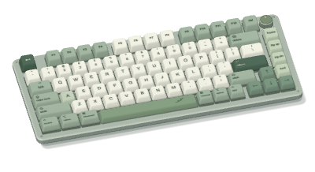

# Sage Keys for Mac v0.1 驗收

[v0.2.4 DMG 安裝與實測](INSTALL-v0.2.4.md) · [v0.2.3 導覽循環與安裝生命週期](LIFECYCLE-v0.2.3.md) · [v0.2.2 安裝身分、圖解及實測](DIAGNOSTICS-v0.2.2.md) · [v0.2.1 授權導覽與驗收](PERMISSIONS-v0.2.1.md) · [v0.2 版本紀錄](TESTING-v0.2.md)

**版本 B，可下載的 Apple Silicon 個人測試版。** 在標準 GitHub-hosted `macos-15` ARM64 虛擬機使用 Xcode 16.4、Swift 6.1.2 編譯，實際運行系統為 macOS 15.8.2（24H232），部署下限 13.0。執行程式提交為 `f23b339`。工作流程使用唯讀 repository 權限，本次 11 組原生檢查全部通過。[原始碼版本](https://github.com/AnneCat-bit/sage-keys/tree/f23b339/macos) · [完整 Actions log](https://github.com/AnneCat-bit/sage-keys/actions/runs/44912535484) · [編譯摘錄](evidence/build-excerpt.txt)

[下載 App](https://github.com/AnneCat-bit/sage-keys/actions/runs/44912535484/artifacts/14710202421) · [該次執行的原始測試 Artifact](https://github.com/AnneCat-bit/sage-keys/actions/runs/44912535484/artifacts/14710087844) · [安裝及授權](README.md)

## 原生系統、桌面與模擬輸入

| 證據層級 | 實際操作 | 結果 |
| --- | --- | --- |
| 原生編譯、解壓及啟動 | 建立 arm64 Mach-O App，以 ditto 封裝，再解開個人測試 ZIP，驗證簽章並啟動解開的實際執行檔。 | App 啟動，Runner 取得進程與 RSS。從 GitHub 重新下載的內層 ZIP 為 649,777 bytes，SHA-256 與編譯產物一致。 |
| 真實系統安全評估 | 對解開的 App 執行 codesign 與 Gatekeeper 評估。 | 資源封印及 ad-hoc 簽章通過。Gatekeeper 回報 rejected，exit 3，沒有 Developer ID、Team ID 或公證票據。網路下載後的首次手動放行仍須在目標裝置驗證。[簽章紀錄](evidence/gatekeeper.txt) |
| 真實 macOS 視窗與前景 | 用同一套 AppKit 程式建立 400 × 250 NSPanel，切換一般／置頂、隱藏、顯示，啟動並啟用真正的 TextEdit，再把桌寵移到前面。 | 面板可見，canBecomeKey 為 false，TextEdit 保持前景。此項測試送往系統的鍵盤事件為 0。 |
| 真實 WKWebView，模擬物理狀態 | 從 Swift 經正式橋接路徑按住 A 與 Space，再單獨放開 Space、最後放開 A。直接讀取 WebGL framebuffer。 | 兩鍵改變 2,768 個像素，只剩 A 時為 326，最後為 0。過程共建立一個 WebGL context。 |
| 真實 WebKit 音訊 | 對三個內置 WAV 依次選音色、觸發 Enter，讀取解碼資料及壓縮器後的 PCM。 | Rainy 75、Topre、Brown 各有 33,552、36,000、35,856 個解碼取樣，音源啟動時均為 running。三次實測混音峰值分別為 0.457、0.419、0.308。 |
| 真實離線資產路徑 | WKWebView 自 bundle 的 file URL 載入，在預設封鎖連線的 CSP 下執行完整模型、輸入橋接與聲音測試，最後引發一次刻意的外連。 | App 的 JavaScript fetch 次數為 0。測試外連遭拒並收到 connect-src 的 CSP 違規事件。Runner 的整機網路介面維持可用。 |
| 真實權限 API 與受控拒絕 | Runner 的實際 listen-access preflight 為 true。測試在獨立 QA bundle 的同一條主執行緒上建立真正的 listenOnly tap 並立即移除，期間未讓 run loop 分派實際按鍵。另以測試限定開關模擬拒絕。 | OS 成功建立並移除 tap。未啟用及模擬拒絕均未安裝 tap。未替使用者在 TCC 對話框選擇授權。 |
| 模擬鍵位與生命週期 | 在記憶體測試 82 個位置、A/S、多鍵、左右修飾鍵、Space、Enter、Backspace、重複鍵及清空。以睡眠通知測試停用，並實際隱藏／顯示視窗。 | 左右 Shift 可獨立放開，重複事件排除。隱藏時新增繪製與音源皆為 0，恢復後試敲有聲音。 |
| 真實釋放 | 執行正式退出清理流程，等待 Web Audio 關閉及 WebGL 釋放，檢查 Swift 弱參考。 | AudioContext 已 closed、WebGL context 已失效、畫布數量 0。原生顯示控制器與 WKWebView 均已釋放。 |

原生測試的事件與效能資料全來自固定的 QA 案例。量測探針、CSP 外連測試和測試鍵序列只在另外編譯的 QA App 內執行。個人測試 ZIP 內沒有這個 QA App。[原始結果](evidence/mac-results.json) · [原生測試 log](evidence/native-tests.log) · [驗收程式](Tests/main.swift)

另從 GitHub 下載最終 Artifact，核對內層 ZIP、arm64 標頭、bundle 資源清單及三個原始 WAV 的完整位元組。正式 GitHub Pages 重跑工作室八組檢查與 Document PiP 回歸，涵蓋子路徑重新整理、原生組字、三種錄音、400 × 250／300 × 190 小窗及同一畫布還原。補充的 Linux Chromium 在本環境受管理政策限制，無法直接開啟 file URL。上表的本機檔案載入及封網測試在目標 macOS WKWebView 執行。[正式網站](https://annecat-bit.github.io/sage-keys/)

## CPU、記憶體與渲染

以下使用同一次 Runner 驗收。在 AppKit 程序與本次新出現的三個 WebKit 服務上讀取 ps 的 CPU 累積時間和 RSS。每約半秒取樣，只計入前後均屬同一情境的區間。CPU 為時間加權平均，100% 為一個核心。RSS 是區間中位數，服務間可能有共享頁，不能將相加結果當成獨占實體記憶體。[逐區間 CSV](evidence/process.csv) · [量測程式](Tests/processes.py)

| 情境 | 原生程序 CPU | WebKit 服務 CPU 合計 | 原生 RSS | WebKit RSS 合計 | 模型繪製 |
| --- | ---: | ---: | ---: | ---: | --- |
| 靜置 | 0.00% | 0.32% | 75.9 MiB | 186.6 MiB | 另一次 2.3 秒靜置檢查為 0 draw call、0 動畫幀請求 |
| 省電，15 FPS 上限，24 次模擬敲擊 | 1.14% | 6.93% | 75.8 MiB | 183.1 MiB | 10.55 秒內 96 幀，含敲擊間隙平均 9.10 fps |
| 標準，30 FPS 上限，24 次模擬敲擊 | 0.63% | 5.71% | 75.8 MiB | 186.6 MiB | 10.51 秒內 121 幀，含敲擊間隙平均 11.52 fps |

兩次打字情境均使用有聲 A/S，經 Swift 發送當前按住集合。每個 3D 畫面有五次 draw call。靜置檢查當時 WebKit 回報音訊為 interrupted，退出時已確認 closed。本次短樣本中 30 FPS 組的 CPU 讀值較低，數據不足以判斷兩種模式的長期耗電差異。WebKit 程序按開始 QA 後出現的 PID 辨認，包含內容、GPU 等服務的 CPU 時間，沒有測得實體 GPU 功率。全域 tap 沒有參與這些模擬敲擊的效能量測。

開發者可從 GitHub 的 **Actions → Sage Keys for Mac → Run workflow** 重現建置與測試，下載 evidence Artifact。工作流程保留工具鏈、封裝資源雜湊、Gatekeeper 結果、測試 JSON、程序取樣與實際畫布圖。使用者日常操作只需 App。

## 需要 M2 MacBook 驗收的項目

| 項目 | 建議驗收與通過條件 |
| --- | --- |
| 下載安裝、授權及撤銷 | 由 Finder 安裝。測試拒絕時仍可試敲、系統允許後手動啟用、撤銷後桌寵停止。開啟安全鍵盤輸入、鎖定及睡眠後，檢查已暫停、沒有卡鍵，重新啟用前維持靜止。 |
| 真正跨 App 打字 | 在 TextEdit、Word、Chrome／ChatGPT 網站、ChatGPT App 及 Ulysses 逐一允許，再試英文、倉頡、速成、拼音與 Cmd／Option 快捷鍵。驗收文字及候選字在前景 App 正常，桌寵只回應實體鍵位。Runner 未執行真人按鍵、候選字選擇或商業 App 的端對端驗收。 |
| 敏感欄位 | 系統啟用 Secure Event Input 時應停止。瀏覽器或應用自行實作的密碼欄可能沒有標示，輸入敏感資料前手動暫停。 |
| 視窗環境 | 分別在普通桌面、多個 Spaces、全螢幕 Word、Stage Manager 與外接螢幕驗證可見性、拖動、調整大小與焦點。Runner 只實測普通桌面的 TextEdit 前景及一般／置頂層級。 |
| 長時間能耗及音效 | 固定亮度，以活動監視器分別看只有前景編輯器、桌寵靜置、15／30 FPS 連打及隱藏各五分鐘，重複三次。比較 Sage Keys 與 WebKit 的 CPU、記憶體、Energy Impact，並聆聽三種錄音的延遲及音量。風扇、電池續航及機身溫度需實機量度。 |
| 登入項目、版本與更新 | 在要使用的系統版本驗證登入啟動預設關閉、顯式註冊與取消，以及換版後輸入監控的有效性。macOS 13、14、更新系統及管理裝置政策分別待驗。 |
